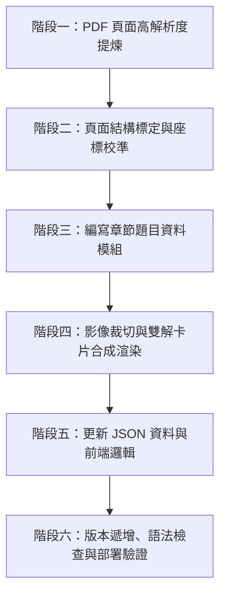

# 國中數學章節處理與自動化部署作業指引 (Codex / AI Agent Guide)

> **文件目的**：本手冊詳細記錄國中數學講義題庫（`math-lesson-app` / PWA）章節處理的完整技術標準、實作流程與部署規範。任何接續本專案之 AI Agent（如 OpenAI Codex、Claude、Gemini 等）必須完全遵循本手冊之規範，以確保題庫品質、卡片視覺一致性與 PWA 線上穩定性。

---

## 1. 專案架構與環境資訊

### 1.1 核心路徑與環境
- **專案根目錄**：`c:\Users\larry\Projects\math-lesson-app\web`
- **原始教材 PDF 目錄**：`../source-pdf/`
  - `questions.pdf`：學生版題目卷（全書各章節題庫）
  - `answers.pdf`：教師版解答卷（含紅字解答與原書詳解）
- **暫存工作目錄**：`../scratch/`（存放原始提煉的高解析度單頁影像）
- **正式發佈圖檔目錄**：`crops/`（存放學生題目截圖與合成詳解卡片）
- **資料描述目錄**：`data/`
  - `data/questions.json`：章節區域（zones）與題目主表（answers, labels, metadata）
  - `data/crops.json`：前端畫布或離線對照用之歸一化座標截圖索引
- **PWA 核心檔案**：
  - `index.html`：主入口（含版本常數 `VER` 與快取破壞參數）
  - `app.js`：前端核心互動邏輯、章節導航與標題映射（`pageSectionTitle`）
  - `sw.js`：Service Worker 離線快取控制（`CACHE` 名稱版本管理）
  - `precache.json`：離線預載清單
- **遠端倉庫**：GitHub Repository `LarryF94046034/math-lesson-pwa`
- **正式線上網址**：`https://larryf94046034.github.io/math-lesson-pwa/`

### 1.2 嚴格禁止事項（安全紅線）
任何 AI 執行任何指令時，**絕對禁止**：
1. **嚴禁使用任何遞迴刪除或強制刪除指令**：禁止 `rm -rf`、`Remove-Item -Recurse` 或類似程式碼。
2. **嚴禁破壞 Git 歷史或強制推送**：禁止執行 `git push --force` 或 `git reset --hard`（若需復原，一律使用 `git revert`）。
3. **嚴禁修改 `.gitignore`**。
4. **嚴禁超出專案根目錄進行非必要操作**（路徑嚴格限制於當前工作目錄及必要之相鄰原始 PDF / scratch 目錄）。
5. **嚴禁清理系統資源回收筒**。

---

## 2. 標準章節處理流程（SOP 六大階段）



---

## 3. 階段一：PDF 頁面高解析度提煉 (PDF Extraction)

### 3.1 頁面尺寸標準
- 所有題目頁與解答頁皆統一標準化為 **寬 1236 像素 × 高 1735 像素**（`1236 x 1735`）。
- 題目檔名命名：`../scratch/q_p{PAGE}_fixed.jpg`
- 解答檔名命名：`../scratch/a_p{PAGE}_fixed.jpg`

### 3.2 提取腳本規範範例 (`extract_pages.py`)
使用 `pypdfium2` 或 `fitz (PyMuPDF)` 擷取 PDF 影像。需注意：
- 必須排除底圖浮水印（如 `Im0.jpg` 或純背景色塊）。
- 確保影像轉正（若有旋轉角度需校正為標準直式方向）。
- 縮放為 `1236 x 1735` 並以高畫質 JPEG（quality=95）存檔。

```python
# 範例提取程式碼片段
import pypdfium2 as pdfium
from PIL import Image

PAGE_W, PAGE_H = 1236, 1735

def extract_chapter_pages(pdf_path, page_start, page_end, prefix):
    pdf = pdfium.PdfDocument(pdf_path)
    for p_idx in range(page_start - 1, page_end):
        page_num = p_idx + 1
        page = pdf[p_idx]
        bitmap = page.render(scale=2.0)
        img = bitmap.to_pil().resize((PAGE_W, PAGE_H), Image.Resampling.LANCZOS)
        out_name = f"../scratch/{prefix}_p{page_num}_fixed.jpg"
        img.save(out_name, "JPEG", quality=95)
```

---

## 4. 階段二：頁面結構標定與座標校準 (Calibration)

### 4.1 國中講義版面結構特性
國中講義每一章通常包含六大板塊：
1. **重點範例、演練、繼續來挑戰**（左右雙欄對應）：
   - 左欄：`範例 X`（X 座標約 `70 ~ 600`）
   - 右欄：`演練 X`（X 座標約 `600 ~ 1160`）
   - 下方全寬欄：`繼續來挑戰 X`（X 座標約 `70 ~ 1160`）
2. **試題搶先做 — 一、基礎題**（單欄或雙欄選擇／計算）
3. **試題搶先做 — 二、精熟題與素養題組**
4. **試題搶先做 — 三、優良經典題（歷屆會考題）**
5. **會考非選精熟試題**（計算題大題）
6. **資優挑戰題**（高難度競賽題）

### 4.2 座標標定方式
- 撰寫小型校準腳本（如 `calibrate_sec1.py`），利用 `PIL.ImageDraw` 在頁面上繪製輔助紅線／框線，輸出至 `overview_{chapter}/` 檢視。
- 切割座標 `(x1, y1, x2, y2)` 必須緊貼題目文字上方邊界，並在下方預留合理邊距，切勿切到上一題題尾或下一題題號。

---

## 5. 階段三：編寫章節題目資料模組 (Data Definition)

將章節題目分為數個模組（例如 `jh2_4_data_sec1.py`, `jh2_4_data_sec2.py`, `jh2_4_data_sec3456.py`），利於維護與校對。

### 5.1 題目資料物件 Schema 規範
每個題目物件包含以下必備欄位：

```python
{
    "id": "jh2_4-p130-範例_1",        # 全局唯一 ID: jh{章節}-p{頁碼}-{分類}_{編號}
    "page": 130,                       # PDF 原始頁碼
    "slug": "範例_1",                  # 頁內標識
    "label": "2-4 範例 1",             # 顯示於導航與標題的名稱
    "answer": "-125/64（-1.953125）",   # 正確答案字串（含分數與小數對應）
    "student_box": (70, 1100, 595, 1340), # 題目截圖座標 (x1, y1, x2, y2)
    "teacher_box": (70, 1100, 595, 1460), # 解答截圖座標（當 sol_custom=False 時使用）
    "sol_custom": False,               # 是否為全自製解答卡（True 則使用 steps 渲染）
    
    # 🌿 國中其他解法／另解與速解技巧（綠色卡片必備內容）
    "other_jh_steps": [
        "【符號與乘方快速判斷法】",
        "1. 奇次保號：負數的奇數次方結果必為負數，先確定符號為「-」。",
        "2. 分子分母分別乘方：(-5/4)^3 = -(5^3 / 4^3) = -125/64。",
        "3. 化為小數心算技巧：-125/64 = -(1 + 61/64) = -1.953125。"
    ],
    
    # 🔮 高中／大學進階觀點與速解（紫色卡片必備內容）
    "advanced_steps": [
        "【高中／大學進階觀點：二進位浮點數與有限小數判定】",
        "1. 有限小數充分必要條件：最簡分數分母質因數僅含 2 或 5 時必為有限小數。分母 64 = 2^6，故小數位數必為 6 位。",
        "2. 計算機 IEEE 754 浮點表示：64 為 2 的冪次，在二進位中為精確值 -1.111101_2，無截斷誤差。"
    ]
}
```

### 5.2 雙解內容設計標準
每一道題目**均須提供雙解擴充**：
1. 🌿 **國中其他解法／另解與速解技巧**：
   - 包含：快速心算法、十字交乘直觀法、因數分解速算、圖形幾何代數幾何化、排除法、代入檢驗法等「國中生能理解且考試能省時的技巧」。
2. 🔮 **高中／大學進階觀點與速解**：
   - 包含：二項式定理、模運算（同餘 Congruence）、遞迴數列、因數個數公式 $\tau(n)$、歐幾里得輾轉相除法深層原理、抽象代數群環概念、浮點數表示、對數換底或極限思維等。

---

## 6. 階段四：卡片渲染引擎與組合生成 (Card Rendering Engine)

詳解卡片採用 PIL 自動動態佈局渲染，結合原始教師手寫／印刷解答與雙解擴充卡片。

### 6.1 視覺與色彩規範
- **中文字體**：Windows 內建微軟正黑體
  - 一般文字：`C:\Windows\Fonts\msjh.ttc`（或 `msjh.ttf`）
  - 粗體標題：`C:\Windows\Fonts\msjhbd.ttc`
- **卡片配色標準**：
  - 🌿 **國中其他解法卡片**：
    - 背景色：`#eafaf1`（薄荷粉綠）
    - 外邊框：`#1e7a46`（深翡翠綠，線寬 2px）
    - 頂部標題底色：`#d4efdf`
    - 標題文字：`#145a32`（加粗）
    - 內文文字：`#194d33`
  - 🔮 **高中大學進階觀點卡片**：
    - 背景色：`#f4ecf7`（薰衣草粉紫）
    - 外邊框：`#6c3483`（高貴深紫，線寬 2px）
    - 頂部標題底色：`#e8daef`
    - 標題文字：`#512e5f`（加粗）
    - 內文文字：`#2c3e50`
  - 標題列與答案框：
    - 頂部 Header：背景 `#eaf2f8`，邊框 `#2980b9`，文字 `#1b4f72`
    - 答案徽章：背景 `#1e7a46`，文字純白 `#ffffff`

### 6.2 詳解圖檔合成模式
1. **模式 A：`sol_custom = False`（原書解答截圖 + 底部附加雙解卡片）**
   - 從 `a_p{PAGE}_fixed.jpg` 中按 `teacher_box` 裁切出解答圖。
   - 計算雙解卡片所需高度，將卡片依序垂直拼接於原書解答圖下方。
   - 輸出至 `crops/{id}_sol.jpg`。
2. **模式 B：`sol_custom = True`（全自製完整高解析解答卡）**
   - 當原書解答字跡模糊、排版混亂或需要精細排版時使用。
   - 呼叫 `make_full_solution_card()`，渲染包含標題、標準步驟、答案方框、國中另解、進階觀點的整張獨立高解析卡片。

---

## 7. 階段五：資料庫與前端串接 (Data Integration)

### 7.1 `data/questions.json` 更新
1. 在 `zones` 陣列中註冊該章節物件：
```json
{
  "id": "jh2_4",
  "category": "國中數學",
  "chapter": "2-4",
  "title": "2-4 指數律",
  "name": "2-4 指數律",
  "pages": "第 130–139 頁（重點範例・基礎・精熟・會考・資優）",
  "description": "國中數學一上｜重點範例演練、基礎題、精熟題、經典會考與資優挑戰（附完整詳解、國中速解技巧與進階觀點）",
  "asset": "1上國中講義數學測驗卷.pdf",
  "questionCount": 51
}
```
2. 在 `questions["jh2_4"]` 陣列中加入所有題目清單：
```json
{
  "id": "jh2_4-p130-範例_1",
  "page": 130,
  "label": "2-4 範例 1",
  "answer": "-125/64（-1.953125）"
}
```

### 7.2 `data/crops.json` 索引更新
每個題目加入歸一化座標（Normalized Coordinates，除以 1236 與 1735）：
```json
{
  "source": "1上國中講義數學測驗卷.pdf",
  "page": 130,
  "box": [0.0566, 0.634, 0.4814, 0.7723],
  "out": "crops/jh2_4-p130-範例_1.jpg"
}
```

### 7.3 `precache.json` PWA 離線預載更新
將新增的所有 `crops/{id}.jpg` 與 `crops/{id}_sol.jpg` 加入清單中，確保離線可讀取。

### 7.4 `app.js` 導航標題更新
在 `pageSectionTitle(zoneId, page)` 加入該章節的分頁對應：
```javascript
if (zoneId === "jh2_4") {
  if (page >= 130 && page <= 133) return `第 ${page} 頁｜重點範例・演練・繼續來挑戰`;
  if (page >= 134 && page <= 135) return `第 ${page} 頁｜2-4 試題搶先做 — 一、基礎題（附詳解與速解觀點）`;
  if (page === 136) return `第 136 頁｜2-4 試題搶先做 — 二、精熟題與素養題組`;
  if (page === 137) return `第 137 頁｜2-4 試題搶先做 — 三、優良經典題（歷屆會考・附高解析詳解）`;
  if (page === 138) return `第 138 頁｜會考非選精熟試題`;
  if (page === 139) return `第 139 頁｜資優挑戰題`;
}
```

---

## 8. 階段六：版本管理、語法驗證與部署發佈 (Deployment)

### 8.1 三處版本同步遞增原則
每次更新發佈，必須**同時修改以下三處檔案之版本號**（例如由 `v32` 遞增為 `v33`）：
1. `app.js`：
   - 頁尾版本顯示標籤：`<p class="muted">版號 v33</p>`
2. `sw.js`：
   - 快取名稱常數：`const CACHE = "math-lesson-pwa-v33";`
3. `index.html`：
   - 快取破壞常數：`const VER = "v33-allow";`
   - 模組導入參數：`<script type="module" src="app.js?v=33"></script>`

### 8.2 程式碼語法檢查 (Zero Error Verification)
部署前必須在終端執行語法編譯檢查：
```bash
node -c app.js
node -c sw.js
```
確保回傳代碼為 0 且無語法錯誤。

### 8.3 Git 安全提交與發佈指令序列
嚴格執行精確路徑暫存與乾淨提交：
```bash
# 1. 檢查 git 狀態
git status

# 2. 加入更動檔案
git add app.js sw.js index.html precache.json data/ CODEX_GUIDE.md generate_full_jh2_4.py generate_jh2_4_base.py jh2_4_data_*.py crops/jh2_4-*

# 3. 提交具描述性的 commit 訊息
git commit -m "Add Junior High Chapter 2-4 (指數律) with dual alternative and advanced cards (v33)"

# 4. 推送至 GitHub
git push origin main
```

### 8.4 監控 GitHub Pages 部署狀態
推送後可透過 GitHub CLI 檢查自動建置狀態：
```bash
gh run list --limit 1
```
等待狀態顯示為 `completed / success` 即代表正式上線成功。

---

## 9. 常見問題與除錯指南 (Troubleshooting)

| 異常現象 | 常見成因 | 標準解決方案 |
| :--- | :--- | :--- |
| 題目文字邊緣被切到 | 座標校準 y1 太大或 y2 太小 | 利用 `ImageDraw` 繪製框線輸出縮圖，手動增加 15~30 px 安全邊距 |
| 詳解卡片文字折行溢出 | 未做字串長度與半全形寬度折行計算 | 使用模組中的 `wrap_text()` 輔助函數依像素寬度自動切行 |
| 手機端仍看到舊版快取 | Service Worker 未觸發 Activate | 確保 `sw.js` 的 `CACHE` 名稱已更換，並確保 `index.html` 的 `VER` 參數已更新 |
| `data/questions.json` 報錯 | JSON 中有未跳脫字元或格式錯誤 | 在 Python 執行 `json.load()` 檢驗語法合法性 |
| GitHub Pages 404 找不到檔案 | Jekyll 引擎忽略底線開頭或特殊檔案 | 根目錄必須具備 `.nojekyll` 空檔案 |

---
*本文件建立於 2026 年，為本專案標準作業規章。接續開發之 Agent 請恪遵此手冊指引！*
